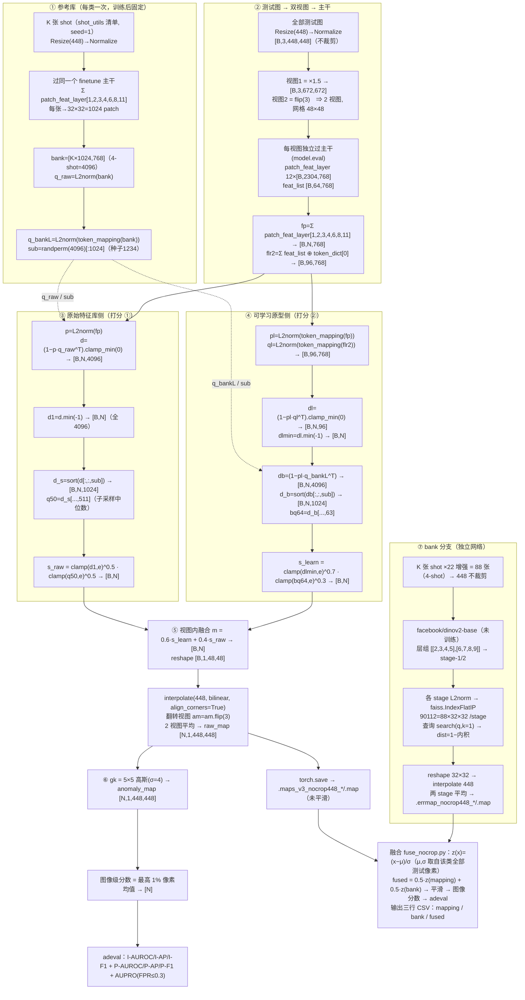

# 推理流程与异常打分细节（逐张量核对版）

> 生成时间：2026-10-13
> 依据：`eval_score_v3.py`（当前生产推理）、`eval_nocrop.py`（旧打分对照）、`code_vpt4/main-fewshot-vpt4.py` 的
> `build_raw_bank` / `compute_fused_map` / `get_gaussian_kernel` / `ader_evaluator`、
> `cache_bank_nocrop.py` + `code_vpt2/util/memorybank.py`、`fuse_nocrop.py`。
> **文中张量形状全部由 `probe_infer_shapes.py` 在 VisA 4-shot / candle / B=4 上实跑打印得到**（见 §10），不是推算。

---

## 1. 推理脚本与参数

生产入口 `eval_score_v3.py`，做三件事：(1) 按给定配方重推该类全部测试图的异常图；
(2) 把**未平滑**异常图落盘（供融合/可视化复用）；(3) 用官方 `adeval` 出该类 mapping-only 七项指标并打印 `CSV:` 行。

| 参数 | 生产值 | 含义 |
|---|---|---|
| `--shots` | 4（VisA 4-shot）/ 2（MVTec 2-shot）/ 4（MVTec 4-shot） | shot 数，决定参考库大小 |
| `--size` | 448 | 测试输入边长（**不裁剪**） |
| `--scales` | `1.5` | TTA 尺度 |
| `--flip` | 1 | 是否加入水平翻转视图 |
| `--raw_alpha` | 0.5 | 原始库侧：局部项指数 |
| `--raw_global` | 512 | 原始库侧：全局项分位（1024 子采样中第 512 小 = 中位数） |
| `--l_alpha` | 0.7 | 可学习侧：局部项指数 |
| `--l_global` | 64 | 可学习侧：全局项分位（1024 子采样中第 64 小） |
| `--w` | 0.6 | **可学习侧**权重（原始库侧 = 1−w = 0.4） |
| `--sub_seed` | 1234 | 分位数子采样索引的随机种子 |
| `--num_tokens` | 32 | 与训练的 `learnable_num_per_layer` 一致 |
| `--ckpt_dir` | `results/<save>` | 取 `model_<cls>_35.pth` 的 `dino` 子字典 |

对照：旧打分 `eval_nocrop.py` 等价于 `raw_alpha=1.0`（`s_raw=d1`）、`l_alpha=1.0`（`s_learn=dlmin`）、`w=0.5`，
且**不使用**映射库分位项。其余流程完全一致，可直接 A/B。

---

## 2. 预处理与测试集顺序

```python
tf  = Compose([Resize((448,448)), ToTensor(), Normalize(ImageNet_mean, ImageNet_std)])
gtf = Compose([Resize((448,448)), ToTensor()])
ds  = mod.MVTecDataset(root=<data_path>/<cls>, transform=tf, gt_transform=gtf, phase='test')
dl  = DataLoader(ds, batch_size=16, shuffle=False, num_workers=4)
```

* **不做 CenterCrop**：训练裁 392，推理不裁、保留全图。
* GT 判定 `(gt > 0.5)`；正常图的 GT 由数据集类补成全 0。
* **图像顺序**：`MVTecDataset.load_dataset` 逐缺陷类型用 `os.listdir`（未排序）拼接、类内 `glob` 有序
  ⇒ 顺序 = 文件系统枚举顺序。本仓库所有脚本共用同一数据类，故 mapping 图 / bank 图 / GT 三者天然对齐；
  外部代码若假定"按类别名排序"会错位（见 §11 P7）。

---

## 3. 视图构造（测试期 TTA）

```python
for s in scales:                       # (1.5,)
    v_img = F.interpolate(img, scale_factor=1.5, mode='bilinear', align_corners=False)
    views = [v_img, v_img.flip(3)]     # 2 个视图
```

* 视图 1：448 上采样 1.5 倍 → **672×672**（patch 网格 48×48）；视图 2：其水平翻转。
* 每个视图**独立**过主干，得到各自网格上的打分图；最后逐视图处理再平均（不是先平均特征）。
* 位置编码插值：`vit_base(img_size=518, patch_size=14, interpolate_antialias=False, interpolate_offset=0.1)`。

---

## 4. 主干输出（实测形状，B=4）

视图 1.5×（672×672）：

```
patch_feat_layer : 12 层 × [4, 2304, 768]      # 2304 = 48×48 patch
feat_list        : 1 项  × [4, 64, 768]        # 64 = layer-0 的可学习 token 被追加两次（各 32）
```

若输入 448：`patch_feat_layer` 为 12 × `[B,1024,768]`（32×32）。
`feat_list` 为 64 的原因见 `vision_transformer.py:431-433`：循环外追加一次 `token_dict['0']`，`i==0` 时再追加一次。

---

## 5. 三处打分的逐步计算

先构造中间量：

```
fp   = Σ_{j ∈ [1,2,3,4,6,8,11]} patch_feat_layer[j]     # [B, N, 768]，N=2304（672 视图）
flr  = Σ feat_list                                       # [B, 64, 768]
flr2 = concat([flr, token_dict['0'].expand(B)])          # [B, 96, 768]  ← 原型集
q_raw   = normalize(bank)                                # [K×1024, 768]，4-shot = [4096, 768]
q_bankL = normalize(token_mapping(bank))                 # [4096, 768] 同一批正常 patch 映射到"学到的度量空间"
sub     = randperm(K×1024)[:1024]  (seed=1234)           # [1024]
```

### 5.1 ① 原始特征库侧（PatchCore 式：min × 库分位）

```python
d    = (1 − bmm(normalize(fp), q_rawᵀ)).clamp_min(0)     # [B, N, 4096]
d1   = d.min(dim=-1)                                     # [B, N]       最近邻距离（旧基线就是它）
ds   = sort(d[:, :, sub], dim=-1)                        # [B, N, 1024] 子采样后升序
q50  = ds[..., 511]                                      # [B, N]       子采样中位数
s_raw = d1.pow(0.5) * q50.pow(0.5)                       # [B, N]
```

* 子采样只用于估分位数；`d1` 仍取**全部 4096** 个的最小值。
* 数值保护 `.clamp_min(1e-6)`；公式实现在 `_pow(local, glob, a) = local^a · glob^(1−a)`，此处 `a = 0.5`。

### 5.2 ② 可学习原型侧（局部 min × 映射库分位）

```python
pl = normalize(token_mapping(fp))                        # [B, N, 768]
ql = normalize(token_mapping(flr2))                      # [B, 96, 768]
dl    = (1 − bmm(pl, qlᵀ)).clamp_min(0)                  # [B, N, 96]
dlmin = dl.min(dim=-1)                                   # [B, N]
db    = (1 − bmm(pl, q_bankLᵀ)).clamp_min(0)             # [B, N, 4096]
dbs   = sort(db[:, :, sub], dim=-1)                      # [B, N, 1024]
bq64  = dbs[..., 63]                                     # [B, N]       子采样第 64 小（≈6.25% 分位）
s_learn = dlmin.pow(0.7) * bq64.pow(0.3)                 # [B, N]
```

* 关键：96 个可学习原型高度冗余（实测 `d̄≈1.02`、跨 patch 对数变异约 0.01），单独做全局项会退化成 min；
  因此全局项用**映射到同一度量空间的 4096 个真实正常 patch**。

### 5.3 ③ 逐视图融合与形状还原

```python
m  = 0.6 * s_learn + 0.4 * s_raw                         # [B, N]，N=2304
m  = m.reshape(B, 1, 48, 48)
am = F.interpolate(m, size=(448,448), mode='bilinear', align_corners=True)   # [B,1,448,448]
if 翻转视图: am = am.flip(3)          # 翻回原空间
anomaly_map = (am_view1 + am_view2) / 2                  # [B,1,448,448]
```

插值时机：**融合之后、平滑之前**（48×48 或 32×32 → 448）。因插值线性，等价于"各分支先插值再融合"；
但**不能**先平滑再插值（会改变有效平滑尺度）。

---

## 6. 后处理与指标

```python
gk = get_gaussian_kernel(kernel_size=5, sigma=4)   # 5×5，σ=4，padding=2，深度可分离卷积，权重已归一化
anomaly_map = gk(anomaly_map)                      # [N,1,448,448]
flat = anomaly_map.flatten(1)                      # [N, 200704]
k    = int(0.01 * flat.shape[1])                   # 2007
image_score = sort(flat, descending=True)[:, :k].mean(dim=1)     # [N]
```

| 指标 | 输入 | 实现 |
|---|---|---|
| I-AUROC / I-AP / I-F1 | `image_score` vs 图标签 | sklearn `roc_auc_score` / `average_precision_score` / 自实现 best-F1 扫描 |
| P-AUROC / P-AP | 平滑后像素图 vs 像素 GT | `adeval.EvalAccumulatorCuda`，**200 条阈值带**覆盖 `[anomap_min, anomap_max]` |
| P-F1 | 同上 | 全部像素的 best-F1 扫描 |
| P-AUPRO | 同上 | PRO 曲线在 **FPR ≤ 0.3** 的积分（`adeval/iterative.py:136-147`） |

**7 项平均** = 上述 7 项的未加权算术平均（本项目自定义汇总口径）。
已验证：对异常图做严格单调变换（平方/开方/log/×10）→ 7 项变化 ≤0.0024（AUPRO ≤0.0005），
即本实现下评测本质等价于排序类指标，不受分数尺度/形状影响。

---

## 7. 落盘格式

```python
torch.save(raw_map.cpu(), f"{save_maps_dir}/{cls}.map")   # float32 [N,1,448,448]，**未平滑**
```

* `N` = 该类测试图数（VisA candle = 200，MVTec transistor = 100）；
* 该文件是融合脚本 `fuse_nocrop.py --map_dir` 的输入；
* 每次运行还会打印：`[v3] <cls> raw(d1^0.5*q512) learn(dlmin^0.7*bq64) w=0.6` + 7 项指标 + `CSV:` 行。

---

## 8. bank 分支（独立路径）

### 8.1 建库

```
K 张 shot → augmentation()（22 变体/张） → 88 张（4-shot）
→ 448 缩放不裁剪 → facebook/dinov2-base（AutoModel, output_hidden_states=True）
→ extract_fused_features(fuse_layer_encoder=[[2,3,4,5],[6,7,8,9]]) → stage-1 / stage-2
→ 各 stage L2 归一化 → faiss.IndexFlatIP(GPU) → 每 stage 90112 = 88×32×32 个向量
```

### 8.2 查询（`MemoryBank.query_batch`）

```
测试图 → 同一 dinov2-base → 两 stage 特征
→ 每 stage faiss.search(q, k=1)（硬编码）→ dist = 1 − 内积
→ reshape (B,32,32) → interpolate 448（bilinear, align_corners=True）
→ bank_map = (stage1 + stage2) / 2                       # [B,1,448,448]，未平滑 → 落盘
```

要点：
* bank 用的是 **HuggingFace `facebook/dinov2-base`**，与 mapping 分支那个 finetune 过的本地 `vit_base` **不是同一个网络**；
* `k=1` 硬编码；要试分位数类打分需改成 `k>1`（已另做实验，见 `SCORING_SEARCH_2026-10-13.md` §6.1）；
* `query_image()`（按路径查询）里有一段逐图 `/= max` 归一化，但**批量推理走 `query_batch()`，没有这一步**，
  因此落盘 bank 图是原始距离量纲。

---

## 9. 融合（`fuse_nocrop.py`）

```python
M = load(<map_dir>/<cls>.map)        # mapping 图，未平滑 [N,1,448,448]
B = load(<bank_dir>/<cls>.map)       # bank 图，未平滑
assert M.shape == B.shape            # 只校验形状，不校验图像身份
z = lambda x: (x − x.mean()) / (x.std() + 1e-8)          # ★ 统计量取自该类**全部测试像素**
fused = w * z(M) + (1 − w) * z(B)                        # w = mapping 权重（当前 0.5；旧交付 0.3）
anomaly_map = gk(fused) → 图像分数 top-1% → adeval
打印三行：CSV,<cls>,mapping / bank / fused
```

* GT 与标签由脚本重新用 `MVTecDataset(phase='test')` 以同一顺序加载；
* `w` 是 **mapping 权重**，与 `eval_score_v3.py` 的 `--w`（可学习侧权重）语义不同；
* 该步骤为 transductive（z 的均值/方差来自测试集）；基线与新方法共用，A/B 公平，但绝对数字非纯归纳式。

---

## 10. 实跑输出（`probe_infer_shapes.py`，VisA 4-shot / candle / B=4）

```
patch_size=14  img_size(构建)=518  num_register_tokens=4  fused_layer=[1,2,3,4,6,8,11]
[库] shot 图: (4, 3, 448, 448)
[库] bank(raw patch 库, 未归一化): (4096, 768)  = 4 shot x 1024 patch/shot
[库] q_raw(归一化): (4096, 768)；映射后可学习空间库: (4096, 768)
[库] 全局分位数子采样索引: (1024,)（种子 1234）
[输入] 448 图: (4, 3, 448, 448)
[视图 1.0x] patch 网格 32x32；patch_feat_layer: 12 层 x (4,1024,768)；feat_list: 1 项 x (4,64,768)
    fp=Σpatch_feat_layer[1,2,3,4,6,8,11]=(4,1024,768)；flr=(4,64,768)；⊕锚点 → 原型集 (4,96,768)
    ① 原始库侧: d=(4,1024,4096) → 排序子采样 (4,1024,1024)；d1=(4,1024) q50=(4,1024)
    ② 可学习侧: pl=(4,1024,768) ql=(4,96,768) dl=(4,1024,96) → dlmin=(4,1024)；db=(4,1024,4096) → bq64=(4,1024)
[视图 1.5x] 输入 (4,3,672,672)；patch 网格 48x48；patch_feat_layer: 12 层 x (4,2304,768)
    fp=(4,2304,768)；d=(4,2304,4096) → d1/q50=(4,2304)；dl=(4,2304,96)；db=(4,2304,4096) → bq64=(4,2304)
```

量级参考（VisA candle 4-shot 测试图实测分位数）：

| 位置 | p50 量级 | 说明 |
|---|---|---|
| 原始库侧 `d1` | ≈0.031 | 最近邻距离 |
| 原始库侧 `q50` | ≈0.474 | 距离分布中位数（1024 子采样） |
| 可学习侧 `dlmin` | ≈0.006 | 到最近可学习原型 |
| 可学习侧 `d̄(bank)` | ≈1.02 | 到映射库的平均距离 ≈1（近似正交），故必须用 min 类统计量 |

---

## 11. 实现层面的坑

| # | 坑 | 说明 |
|---|---|---|
| P1 | `--shots` 必须与训练一致 | 库由 `shot_utils` 清单决定；传错会静默换库，且形状仍匹配不报错 |
| P2 | 权重固定取 `model_<cls>_35.pth` | 脚本硬编码 `_35`（训练每 5 轮存一次，共 7 个快照） |
| P3 | `num_tokens / metric_head / global_proto / res_mapping` 必须与训练一致 | 它们改变 `token_mapping` 结构与原型集；当前推理脚本已硬编码为训练值 32/1/1/0 |
| P4 | 子采样种子固定 1234 | 换种子会小幅改变全局项（实测 4 类均值漂移 ≤0.20） |
| P5 | 翻转视图必须翻回 | 否则与视图 1 空间错位后平均 |
| P6 | 插值必须在融合后、平滑前 | 先平滑再插值会改变有效平滑尺度 |
| P7 | `fuse_nocrop.py` 只校验形状 | 两个 .map 若来自不同图像顺序不会报错，会静默错配（跨数据集/换数据根时需注意） |
| P8 | 显存/耗时 | 每张测试图 2 次 672×672 主干前向；B=16 时距离矩阵 [16,2304,4096] float32 ≈ 604 MB 中间量 |

---

## 12. 流程图

* 位图/矢量图：`logs/score_flow_mapping.png`（约 2300×3500）、`logs/score_flow_mapping.svg`
  （由 `draw_score_flow.py` 生成，可重新出图）。
* Mermaid 文本版（便于在编辑器里渲染与版本管理）：


